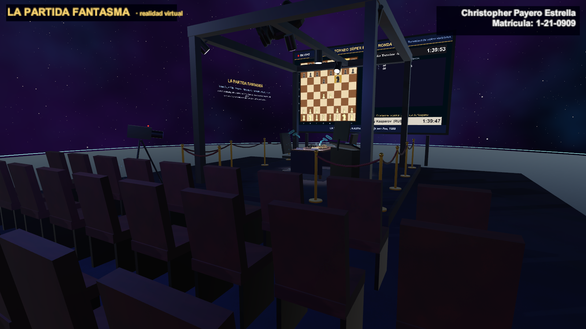

# La Partida Fantasma VR

Espacio de **realidad virtual** hecho en **Unity 6** para la asignatura **Programación de Videojuegos**.

**Alumno:** Christopher Payero Estrella · **Matrícula:** 1-21-0909

- **Probar en el navegador (WebXR):** https://christ2723.github.io/PartidaFantasma/
- **Descargar para Windows (.exe, OpenXR):** [Releases](https://github.com/Christ2723/PartidaFantasma/releases/latest)
- **Investigación (PDF):** [Documentacion/Investigacion RA y RV (1-21-0909).pdf](Documentacion/Investigacion%20RA%20y%20RV%20(1-21-0909).pdf)



## La idea

Una sala de torneo de la élite de la FIDE con un tablero de madera **electrónico tipo DGT**, su reloj, la pantalla gigante
de transmisión y las gradas... pero la sala flota en el vacío, bajo un cielo de estrellas, y frente al tablero no hay nadie.
Un **jugador fantasma**, del que solo se ven unas manos espectrales, mueve las piezas y pulsa el reloj recordando partidas históricas.

| Modo | Qué pasa |
|---|---|
| **Exhibición** | El fantasma reproduce 5 partidas célebres: Kasparov–Topalov (1999), la Inmortal (1851), la Partida de la Ópera (1858), la Partida del Siglo (1956) y Deep Blue–Kasparov (1997). La pantalla, la planilla y el reloj se actualizan solos. |
| **Análisis libre** | Al tomar una pieza el fantasma se aparta. Se marcan las casillas legales y las jugadas ilegales se rechazan. |
| **Duelo** | Juegas con blancas contra el fantasma (motor de ajedrez propio). |
| **Modo Peón** | Te encoges al tamaño de una pieza y caminas por encima del tablero. |

La **consola del árbitro** tiene botones físicos que se presionan con la mano: pausar/seguir, siguiente partida, duelo, reiniciar, Modo Peón y sentarse.

## Controles

| Acción | Visor VR (controles) | Teclado y ratón |
|---|---|---|
| Caminar | Palanca izquierda | WASD / flechas (Shift corre) |
| Girar | Palanca derecha (giro por pasos de 30°) | Clic derecho + arrastrar, Q / E |
| Señalar y tomar una pieza | Gatillo (rayo) o botón de agarre (pieza cercana) | Clic izquierdo |
| Pausar / seguir al fantasma | B | F o Espacio |
| Siguiente partida | X | N |
| Duelo contra el fantasma | Botón de la consola | J |
| Reiniciar | Botón de la consola | R |
| Modo Peón | A | P |
| Sentarse / levantarse | Botón de la consola | C |
| Ayuda | Y | H |
| Entrar en VR (.exe con visor conectado) | — | V |

## Realidad virtual

- **Windows (.exe):** se abre en pantalla completa (Alt+Enter para ventana). OpenXR con perfiles de Oculus/Meta Touch, Valve Index, HTC Vive, Windows Mixed Reality y KHR Simple.
  Funciona con cualquier visor de PC (Meta Quest con Link o Air Link, Index, Vive...). Sin visor arranca en modo escritorio.
- **Navegador:** WebXR (paquete [WebXR Export](https://github.com/De-Panther/unity-webxr-export)). Desde el navegador del Meta Quest
  se abre la página y se pulsa **ENTRAR EN REALIDAD VIRTUAL**.
- El **nombre y la matrícula** están en la esquina superior derecha en pantalla y también dentro del visor.

## Estructura

Todo se genera desde código, sin modelos ni sonidos descargados:

| Archivo | Qué hace |
|---|---|
| `Assets/Editor/ConstructorProyecto.cs` (+ parciales) | Construye la escena completa: texturas de madera, piezas Staunton torneadas, tablero DGT, reloj, sala, sonidos, interfaz, configuración de VR y compilaciones |
| `Assets/Scripts/Ajedrez/` | Reglas completas (enroques, al paso, coronación, tablas), notación algebraica, las 5 partidas y el motor del fantasma |
| `Assets/Scripts/TableroDGT.cs` | Tablero electrónico: detecta las piezas, valida jugadas y las anima |
| `Assets/Scripts/Jugador.cs`, `ManoVR.cs` | Visitante en VR (cabeza y manos) o en escritorio, Modo Peón |
| `Assets/Scripts/Director.cs` | Modos exhibición, análisis y duelo |
| `Assets/Editor/PruebaAutomatica.cs` | Prueba en modo Play (40 comprobaciones): reglas (perft), partidas, motor, fantasma, modos y capturas |
| `Assets/Plugins/WebGL/WebXRCompat.jspre` | Compatibilidad de WebXR Export 0.25 con Unity 6.6 (Emscripten 4 movió `Browser.mainLoop` a `MainLoop`) |

### Regenerar y compilar (Unity 6000.6.4f1)

```
Unity -batchmode -quit -projectPath . -executeMethod ConstructorProyecto.ConstruirTodo
Unity -batchmode -projectPath . -executeMethod PruebaAutomatica.Ejecutar
Unity -batchmode -quit -projectPath . -buildTarget Win64 -executeMethod ConstructorProyecto.CompilarWindows
Unity -batchmode -quit -projectPath . -buildTarget WebGL -executeMethod ConstructorProyecto.CompilarWebGL
```

También desde el menú **Fantasma** del editor.
